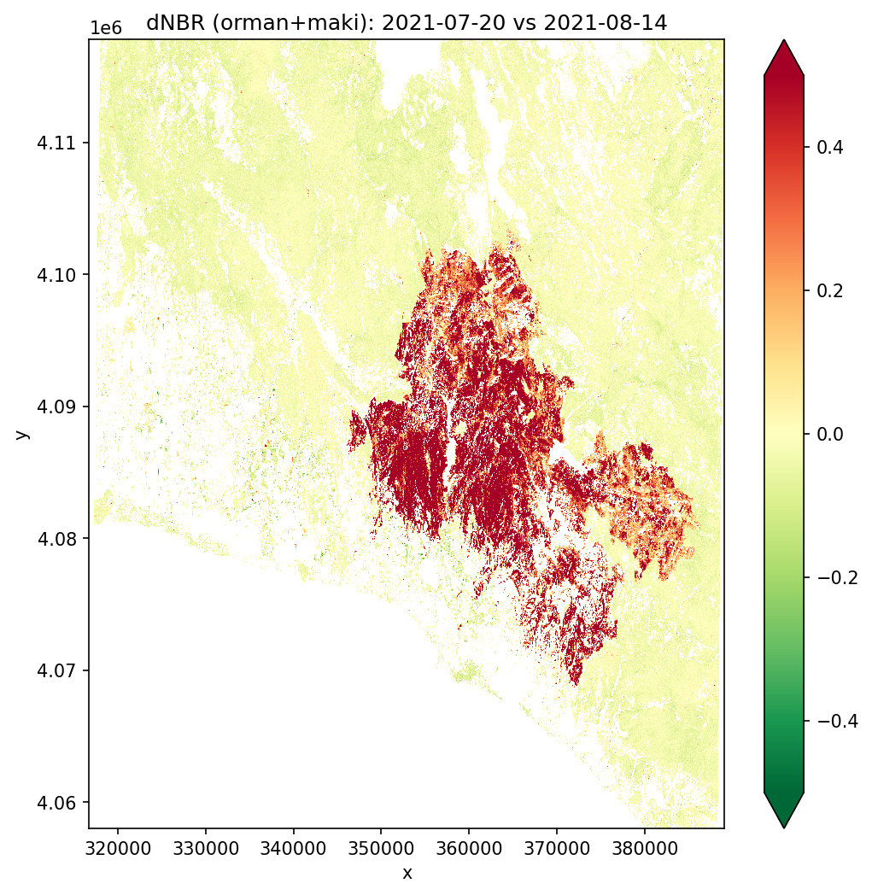
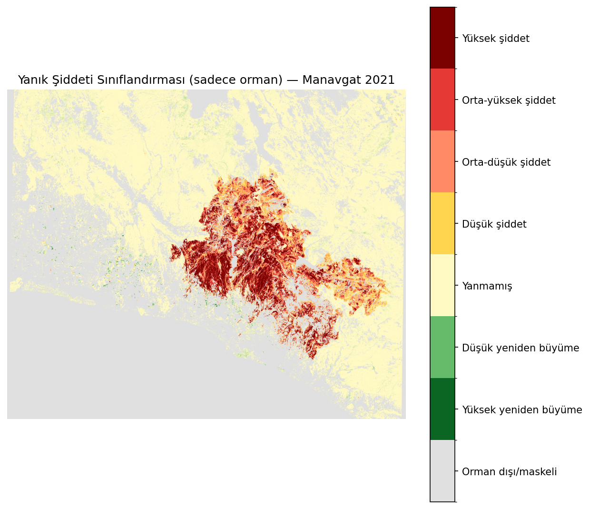
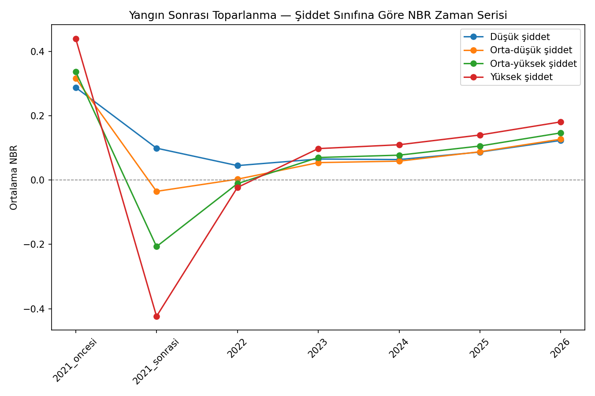
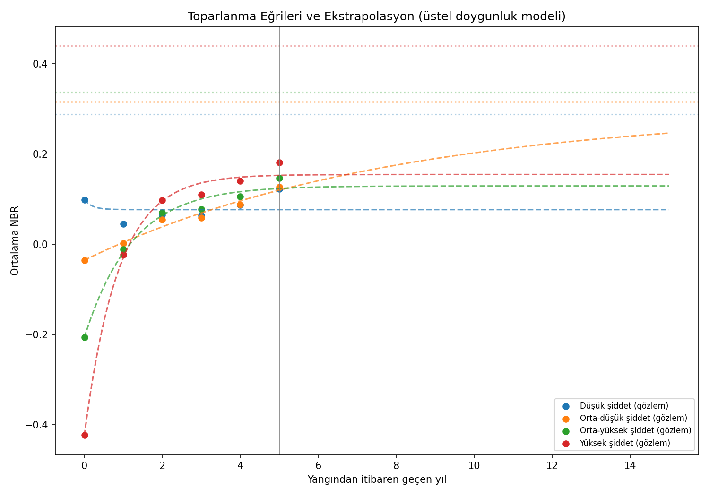
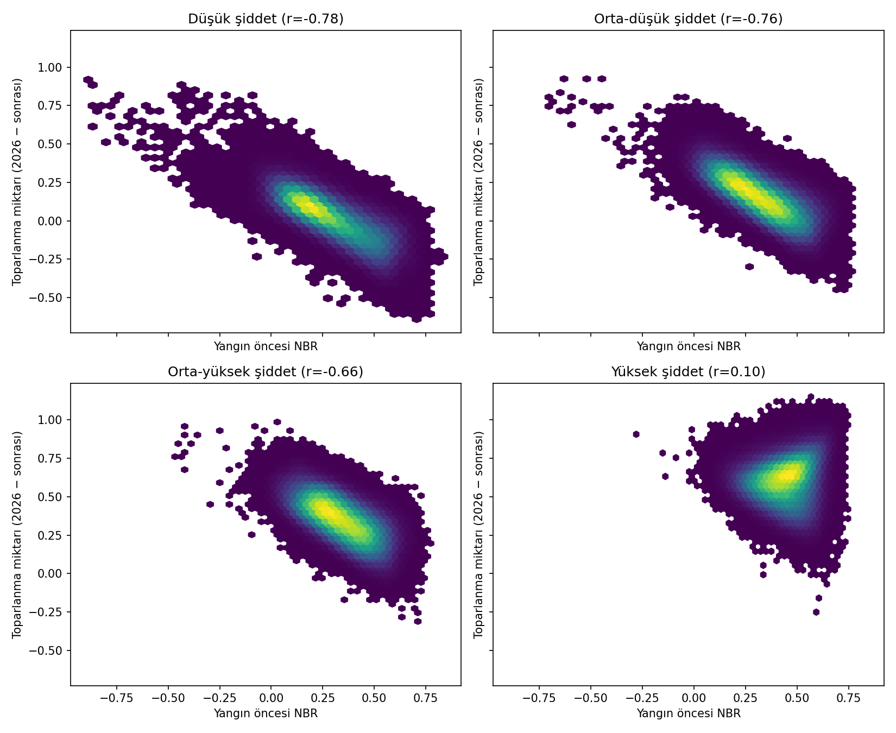
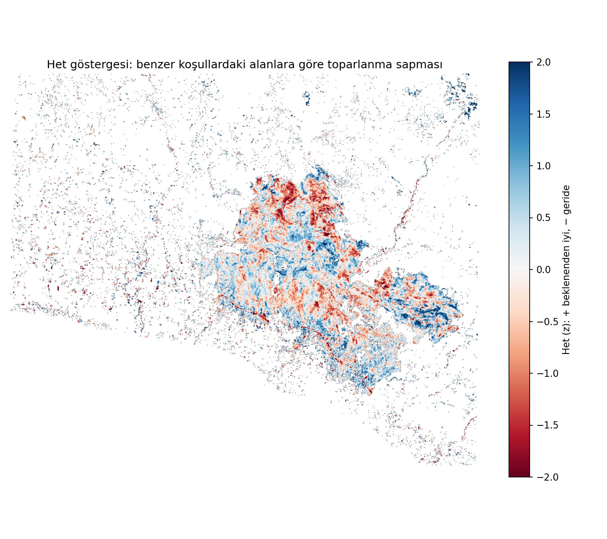

# 🔥🌲 Uydu Görüntüleriyle Orman Yangını Sonrası Toparlanma Takibi
### Satellite-Based Post-Wildfire Vegetation Recovery Tracking — Manavgat 2021

Sentinel-2 uydu görüntülerinden yangının etkilediği alanı ve yanık şiddetini belirleyen, 2021-2026 arasındaki bitki örtüsü toparlanmasını izleyen ve beklenenden farklı toparlanan alanları **Het (Koşullu Toparlanma Sapması)** göstergesiyle haritalayan, tamamen Python ile yazılmış bir uzaktan algılama çalışması.

> **Not (Ekim 2026):** Kodda, 2022 sonrası Sentinel-2 görüntülerinin NBR değerlerini sistematik olarak bozan bir radyometrik ofset hatası düzeltildi (ayrıntılar: [Önemli Düzeltme](#️-önemli-düzeltme-sentinel-2-radyometrik-ofset)). `outputs/` klasöründeki sayısal sonuçlar ve aşağıdaki bulgular **düzeltmeden önce** üretilmiştir; pipeline yeniden çalıştırılıp güncellenmelidir.

---

## İçindekiler

- [Amaç](#amaç)
- [Veri Kaynakları](#veri-kaynakları)
- [Temel İndeksler: NBR, dNBR ve Het](#temel-i̇ndeksler-nbr-dnbr-ve-het)
- [Yöntem](#yöntem)
- [Proje Yapısı](#proje-yapısı)
- [Kurulum](#kurulum)
- [Kullanım](#kullanım)
- [Çıktılar](#çıktılar)
- [Bulgular](#bulgular)
- [Önemli Düzeltme: Sentinel-2 Radyometrik Ofset](#️-önemli-düzeltme-sentinel-2-radyometrik-ofset)
- [Sınırlılıklar](#sınırlılıklar)
- [Planlanan Geliştirmeler](#planlanan-geliştirmeler)
- [Veri Atfı ve Lisans](#veri-atfı-ve-lisans)

---

## Amaç

Bu çalışma, 2021 yılında gerçekleşen **Manavgat/Gündoğmuş orman yangınını** vaka çalışması olarak ele alır ve şu sorulara yanıt arar:

1. Yangının etkilediği alan ve şiddet dağılımı nedir; bu sonuç resmi verilerle ne ölçüde örtüşmektedir?
2. Toparlanma düzeyini belirleyen temel faktör yangının şiddeti midir, yoksa yangın öncesi bitki yoğunluğu ve arazinin kendi özellikleri midir?
3. Bu koşullar ayıklandıktan sonra kalan toparlanma sapması (**Het**) anlamlı, tekrarlanabilir ve mekansal olarak yapılı bir örüntü taşımakta mıdır?
4. Etkilenen alanların yangın öncesi duruma dönmesi ne kadar sürmektedir?

## Veri Kaynakları

Hazır/etiketlenmiş bir veri seti kullanılmaz. Ham çok bantlı görüntüler, belirlenen tarih ve koordinatlar için **Microsoft Planetary Computer STAC API** üzerinden doğrudan çekilir; bulut/su maskeleme, arazi örtüsü filtrelemesi, mozaikleme ve indeks hesaplamaları bu depodaki kodla yapılır.

| Kaynak | Kullanım amacı | Çözünürlük |
|---|---|---|
| Sentinel-2 L2A (B08, B12, SCL) | NBR hesabı, bulut/su/gölge maskesi | 10 m / 20 m |
| ESA WorldCover 2020 | Orman (10) ve çalılık/maki (20) maskesi | 10 m |
| Copernicus DEM GLO-30 | Yükseklik, eğim, yamaç yönü, gölgeleme | 30 m |

Çalışma alanı: `BBOX = [30.95, 36.65, 31.75, 37.20]` (boylam/enlem, WGS84), UTM 36N (EPSG:32636) ızgarasında işlenir.

*Veri erişimi için önce Google Earth Engine değerlendirilmiş, ücretsiz kullanım için dahi ön ödeme talep edilmesi nedeniyle Microsoft Planetary Computer tercih edilmiştir.*

## Temel İndeksler: NBR, dNBR ve Het

**NBR (Normalized Burn Ratio)** — yakın kızılötesi (NIR, B08) ve kısa dalga kızılötesi (SWIR2, B12) bantlarından hesaplanır. Sağlıklı bitki örtüsünde yüksek, yanmış alanda düşüktür:

```
NBR = (NIR − SWIR2) / (NIR + SWIR2)
```

**dNBR (differenced NBR)** — yangın öncesi ve sonrası NBR farkı; yanık şiddetinin ölçüsüdür (Key & Benson, 2006). Sınıflandırmada USGS eşikleri kullanılır:

| dNBR aralığı | Sınıf |
|---|---|
| < −0,25 | Yüksek yeniden büyüme |
| −0,25 – −0,10 | Düşük yeniden büyüme |
| −0,10 – 0,10 | Yanmamış |
| 0,10 – 0,27 | Düşük şiddet |
| 0,27 – 0,44 | Orta-düşük şiddet |
| 0,44 – 0,66 | Orta-yüksek şiddet |
| > 0,66 | Yüksek şiddet |

```
dNBR = NBR(yangın öncesi) − NBR(yangın sonrası)
```

**Het (Koşullu Toparlanma Sapması)** — bir pikselin gözlenen NBR düzeyinin, benzer koşullardaki (yangın öncesi NBR, yükseklik, eğim, kuzey-güney eğimi, dNBR) alanlardan **beklenen** NBR değerinden standartlaştırılmış sapması:

```
Het = (NBR_gözlenen − NBR_beklenen) / σ
```

- **Het > 0**: benzer koşullara göre beklenenden iyi toparlanıyor
- **Het < 0**: beklenenin gerisinde kalıyor

Beklenen değer, komşu pikseller arasındaki benzerlikten kaynaklanan bilgi sızıntısını önlemek için **tamponlu mekansal blok çapraz doğrulaması** (out-of-fold tahmin; test bloğu ve 8 komşusu eğitimden çıkarılır) ile kestirilir. σ için üç varyant incelenir: genel standart sapma (Het-z), koşullu ölçek modeli (Het-σ) ve koşullu kantillerden persentil (Het-P).

## Yöntem

1. **dNBR ve şiddet:** 20.07.2021 (öncesi) ve 14.08.2021 (sonrası) görüntülerinden dNBR hesaplanır, USGS eşikleriyle sınıflandırılır.
2. **Maskeleme:** SCL sınıflarıyla bulut, gölge, su, kar ve nodata; WorldCover ile orman/maki dışı alanlar (tarım, yerleşim vb.) dışlanır.
3. **Doğrulama:** Yanık orman alanı resmi istatistikle (Tarım ve Orman Bakanlığı) karşılaştırılır.
4. **Zaman serisi:** Her yıl için en az bulutlu Ağustos görüntüsü (yıllık seri) ve 15 Temmuz – 15 Eylül penceresindeki tüm bulutsuz görüntüler (yoğun seri) şiddet sınıfı bazında özetlenir.
5. **Toparlanma sürücüleri:** Yangın öncesi NBR, dNBR ve arazi özelliklerinin toparlanmayla ilişkisi sınıf içi korelasyonlarla incelenir.
6. **Tahmin modeli:** Doğrusal regresyon ve Random Forest; naif rastgele piksel ayrımı ile tamponlu mekansal blok ayrımı karşılaştırılır.
7. **Het göstergesi:** Gradient boosting ile mekansal OOF beklenen değer; bilinen toparlanma göstergeleriyle (ham NBR artışı, göreli toparlanma oranı, ham düzey) koşullara bağımlılık açısından karşılaştırma.
8. **Het tanılamaları:** Kantil kalibrasyonu, varyogram, yama analizi, blok boyutu duyarlılığı, konformal kalibrasyon (CQR), beceri eğrisi, aynı yazın farklı tarihleri arasında test-tekrar test güvenilirliği, ölçek ayrıştırması ve aydınlanma (güneş geometrisi) kontrolü.
9. **Toparlanma süresi:** Yoğun seriye doygunluk modeli `NBR(t) = A − (A − N₀)·e^(−t/τ)` uydurulur; parametre belirsizliği Monte Carlo ile yayılır, sonuç doğrusal trend testiyle sağlamlık açısından denetlenir.

## Proje Yapısı

```
wildfire-recovery-cv/
├── src/
│   ├── common.py                    # STAC erişimi, ofset düzeltmesi, maskeleme, mozaikleme, DEM özellikleri
│   ├── fetch_data.py                # (keşif) bölgedeki uygun görüntüleri listeler
│   ├── compute_dnbr.py              # dNBR hesabı → GeoTIFF + önizleme
│   ├── classify_severity.py         # USGS şiddet sınıfları ve alan istatistiği
│   ├── build_timeseries.py          # Yıllık (Ağustos) NBR zaman serisi
│   ├── build_dense_timeseries.py    # Yoğun (tüm bulutsuz yaz görüntüleri) zaman serisi, kaldığı yerden devam eder
│   ├── estimate_recovery_time.py    # Doygunluk eğrisi ile toparlanma süresi
│   ├── analyze_recovery_drivers.py  # Toparlanma sürücüleri + model veri setinin (npz) üretimi
│   ├── model_recovery.py            # LR / RF, naif vs. mekansal blok doğrulama
│   ├── het_core.py                  # Het için ortak araçlar (mekansal katlar, OOF tahmin, persentil)
│   ├── het_method.py                # Het göstergesi, karşılaştırma tablosu ve harita
│   ├── het_diagnostics.py           # Het-z / Het-σ / Het-P, kalibrasyon, varyogram, yamalar
│   ├── het_calibration.py           # Blok boyutu duyarlılığı ve konformal kalibrasyon
│   ├── het_skill.py                 # Model türü × blok boyutu beceri eğrisi, iç içe σ
│   ├── het_reliability.py           # Aynı yazın farklı tarihleri arasında güvenilirlik
│   ├── het_scales.py                # Het'in ölçek bileşenleri ve tekrarlanabilirliği
│   └── het_illumination.py          # Güneş geometrisi / gölgeleme etkisinin kontrolü
├── outputs/                         # Grafikler, tablolar ve ara veriler
├── requirements.txt
└── README.md
```

## Kurulum

Python 3.10+ önerilir.

```bash
git clone https://github.com/hakanEfeTuysuz/wildfire-recovery-cv.git
cd wildfire-recovery-cv
python3 -m venv venv
source venv/bin/activate        # Windows: venv\Scripts\activate
pip install -r requirements.txt
```

Planetary Computer verileri için API anahtarı gerekmez (imzalı URL'ler `planetary-computer` paketi tarafından otomatik alınır). İnternet bağlantısı gereklidir.

## Kullanım

Tüm betikler **depo kök dizininden** çalıştırılmalıdır (çıktı yolları `outputs/` klasörüne görelidir). Önerilen sıra ve bağımlılıklar:

```bash
# 1) Yanık alanı ve şiddet
python src/compute_dnbr.py               # → outputs/dnbr_manavgat_2021.tif
python src/classify_severity.py          # dnbr .tif dosyasını kullanır

# 2) Zaman serileri ve toparlanma süresi
python src/build_timeseries.py
python src/build_dense_timeseries.py     # uzun sürer; kesilirse kaldığı yerden devam eder
python src/estimate_recovery_time.py     # yoğun seriyi kullanır

# 3) Toparlanma sürücüleri ve tahmin modeli
python src/analyze_recovery_drivers.py   # → outputs/recovery_dataset.npz
python src/model_recovery.py

# 4) Het göstergesi ve tanılamaları (hepsi recovery_dataset.npz kullanır)
python src/het_method.py
python src/het_diagnostics.py
python src/het_calibration.py
python src/het_skill.py
python src/het_reliability.py            # ek tarihleri indirir ve önbelleğe alır
python src/het_scales.py                 # het_reliability.py önbelleğine ihtiyaç duyar
python src/het_illumination.py
```

Het betikleri yaklaşık 4 milyon pikselle çalışır; bellek ve süre gereksinimi yüksektir (birkaç GB RAM, betik başına dakikalar-saatler).

## Çıktılar

| Dosya | Üreten betik | İçerik |
|---|---|---|
| `dnbr_preview.png` | compute_dnbr | dNBR haritası (orman+maki) |
| `severity_classified.png` | classify_severity | Şiddet sınıfları haritası |
| `recovery_timeseries.csv/.png` | build_timeseries | Sınıf bazında yıllık ortalama NBR |
| `recovery_timeseries_dense.csv` | build_dense_timeseries | Sınıf bazında tarih-tarih ortalama NBR |
| `recovery_curves.png` | estimate_recovery_time | Uydurulan toparlanma eğrileri |
| `recovery_vs_baseline_vigor.png` | analyze_recovery_drivers | Yangın öncesi NBR – toparlanma ilişkisi |
| `het_comparison.csv`, `het_map.png` | het_method | Göstergelerin koşullara bağımlılığı, Het haritası |
| `het_diagnostics.csv`, `het_variogram.png` | het_diagnostics | Yayılım eşitliği, mekansal yapı |
| `het_skill_curve.csv`, `het_skill.txt` | het_skill | Beceri eğrisi (txt: konsol çıktısı) |
| `het_reliability.csv` | het_reliability | Tarihler arası güvenilirlik |
| `het_scales.csv`, `het_scales.txt` | het_scales | Ölçek bileşenleri |
| `het_illumination_*.csv` | het_illumination | Aydınlanma değişkenlerinin katkısı |

`recovery_dataset.npz`, `nbr_cache_*.npy` ve `*.tif` dosyaları büyük oldukları için depoya eklenmez (`.gitignore`).

## Bulgular

> ⚠️ Aşağıdaki sayılar radyometrik ofset düzeltmesinden **önce** üretilmiştir. Yalnızca 2021 görüntülerine dayanan sonuçlar (yanık alanı, şiddet dağılımı) etkilenmez; 2022 ve sonrasının NBR değerlerine dayanan sonuçlar (zaman serisi, toparlanma miktarı/süresi, model R² değerleri, Het istatistikleri) yeniden hesaplandığında değişebilir.

**Yanık alanı (etkilenmez).** Tahmini yanık orman alanı ≈ **40.656 ha** olup resmi olarak bildirilen rakamın (56.663 ha) yaklaşık **%72**'sine karşılık gelir. Fark büyük ölçüde maskelemeden kaynaklanır: yalnızca orman/maki pikselleri sayılır, bulutlu/gölgeli pikseller ve tarım alanları dışlanır.

**Toparlanma sürücüleri.** Toparlanma düzeyini belirleyen temel faktör yangının şiddetinden çok **arazinin yangın öncesi bitki yoğunluğu**dur; yükseklik ve yamaç yönü ikincil katkı sağlar.

**Tahmin modeli.** Mekansal otokorelasyon etkisi giderildiğinde (tamponlu blok doğrulama) doğrusal regresyon R² ≈ 0,28, Random Forest R² ≈ 0,30 elde edilmiştir; yani koşullar toparlanma düzeyindeki değişkenliğin yaklaşık üçte birini açıklar. Blok boyutu büyüdükçe (5 km) derin ağaç modellerinin becerisi hızla düşer, doğrusal model daha sağlamdır.

**Het göstergesi.**
- Ham toparlanma (NBR artışı) koşullarla büyük ölçüde açıklanırken (dNBR ile r ≈ 0,90), Het koşullardan neredeyse bağımsızdır (tüm koşullarla |r| < 0,04).
- Aynı yazın üç farklı tarihi arasında Het'in tekrarlanabilirliği yüksektir (r ≈ 0,91–0,93); yani ölçüm gürültüsü değil, kalıcı bir sinyal taşır.
- Artık varyansın yaklaşık yarısı 50 m – 1 km ölçeğindedir ve bu bileşen tarihler arasında en tekrarlanabilir olanlardandır (r ≈ 0,94).
- Koşullu ölçek kullanan Het-σ, yayılımı koşul grupları arasında eşitler (σ max/min ≈ 1,0–1,1; Het-z için 1,4–1,6).

**Toparlanma süresi.** Orta-yüksek ve yüksek şiddetli alanlarda yaklaşık 1 yıl içinde bir platoya ulaşıldığı, bu düzeyin yangın öncesinin altında kaldığı gözlenmiştir; düşük ve orta-düşük şiddette veri güvenilir bir süre kestirimine yetmemiştir. **Bu bulgu ofset hatasından doğrudan etkilenir** (bkz. aşağı) ve yeniden değerlendirilmelidir.

| | |
|---|---|
|  |  |
|  |  |
|  |  |

## ⚠️ Önemli Düzeltme: Sentinel-2 Radyometrik Ofset

ESA, **işleme sürümü (processing baseline) 04.00** ile birlikte (25 Ocak 2022'den itibaren üretilen ve sonradan yeniden işlenen ürünler) Sentinel-2 L2A yansıma değerlerine **+1000 DN** ofset eklemiştir (`BOA_ADD_OFFSET = −1000`). Planetary Computer veriyi bu haliyle sunar. Ofset düzeltilmezse:

```
NBR_hatalı = (NIR − SWIR) / (NIR + SWIR + 2000)
```

olur; payda yapay olarak büyür ve 2022 sonrası NBR değerleri sıfıra doğru sıkışır (tipik bitki örtüsünde ~%30-35 küçülme). Bu durum 2021 (ofsetsiz) ile sonraki yılların karşılaştırılmasını sistematik olarak bozar ve örneğin "toparlanmanın yangın öncesi düzeyin altında platoya ulaşması" gibi bir sonucu kısmen ya da tamamen yapay olarak üretebilir.

`src/common.py` artık her karo için `s2:processing_baseline` özelliğini okuyup gerekiyorsa ofseti mozaiklemeden önce uygular. Eski önbelleklerin yanlışlıkla yeniden kullanılmaması için `PIPELINE_VERSION` eklenmiştir: `build_dense_timeseries.py` eski sürümlü CSV'yi yedekleyip baştan başlar, `het_reliability.py` önbellek dosyalarını sürüm numarasıyla adlandırır.

Aynı güncellemede ayrıca şu hatalar düzeltilmiştir:
- SCL nodata pikselleri (`masked=True` ile NaN olan) "geçerli" sayılıyordu; maskeye `notnull` koşulu eklendi.
- Boolean maskeler yeniden örneklenirken kapsama dışı pikseller varsayılan nodata değeri (255) ile doldurulup geçerli görünüyordu; `align_to_reference()` yardımcı fonksiyonu eklendi.
- Yangın sonrası görüntü, yangın öncesi ızgaraya açıkça hizalanmıyordu.
- `model_recovery.py` içindeki `fillna(False)`, yeni pandas sürümlerinde object dtype bırakıp `~` operatörünü bozabiliyordu.
- `requirements.txt` eksikti (pandas, scikit-learn, xarray, pyproj yoktu) ve kullanılmayan ağır paketler (torch, plotly, scikit-image) içeriyordu.
- Şiddet eşikleri ve etiketleri tek bir yerde (`common.py`) toplandı.

## Sınırlılıklar

- Tek bir yangın olayı incelenmiştir; bulguların genellenebilirliği henüz sınanmamıştır.
- NBR bir vekil göstergedir; tür kompozisyonu, biyokütle veya ağaç örtüsünü doğrudan ölçmez. Çalılık/maki hızlı yeşerip NBR'yi orman yeniden oluşmadan yükseltebilir.
- Tarihler arası fenoloji, güneş geometrisi ve atmosferik koşul farkları zaman serisine gürültü katar.
- Müdahale (ağaçlandırma, tahliye), toprak ve mikro-iklim gibi önemli faktörler modelde yoktur; açıklanamayan varyansın büyük kısmı bunlara bağlı olabilir.
- Otomatik test bulunmamaktadır.

## Planlanan Geliştirmeler

- **Genellenebilirlik testi:** Yöntemin 2021'in diğer büyük yangınlarına (Marmaris, Bodrum, Köyceğiz) uygulanması.
- **Kümeleme analizi:** Toparlanma hızına göre bölgelerin gruplandırılması.
- Komut satırı parametreleri (tarih, bölge) ve yapılandırma dosyası.
- Temel birim testleri ve interaktif görselleştirme / gösterge paneli.

## Yöntemsel Not

İlk aşamada toparlanma örüntülerinin kümeleme yöntemleriyle gruplandırılması planlanmıştı. Analiz ilerledikçe daha belirgin bir soru ortaya çıktı: toparlanmayı belirleyen yangın şiddeti mi, arazi özellikleri mi? Bu soru denetimli regresyonla daha doğrudan test edilebildiği için yöntem bu yönde genişletildi; kümeleme ileriki çalışmalara bırakıldı.

## Kaynaklar

- Key, C. H., & Benson, N. C. (2006). *Landscape Assessment (LA): Sampling and Analysis Methods.* USDA Forest Service, RMRS-GTR-164-CD.
- ESA (2022). *Sentinel-2 Processing Baseline 04.00 — introduction of BOA_ADD_OFFSET.*
- Roberts, D. R. et al. (2017). Cross-validation strategies for data with temporal, spatial, hierarchical, or phylogenetic structure. *Ecography*, 40(8).

## Veri Atfı ve Lisans

Copernicus Sentinel verisi içerir (Microsoft Planetary Computer üzerinden işlenmiştir). ESA WorldCover © ESA WorldCover project ([CC BY 4.0](https://creativecommons.org/licenses/by/4.0/)). Copernicus DEM © DLR/Airbus.

Kod MIT lisansı ile sunulmaktadır.
